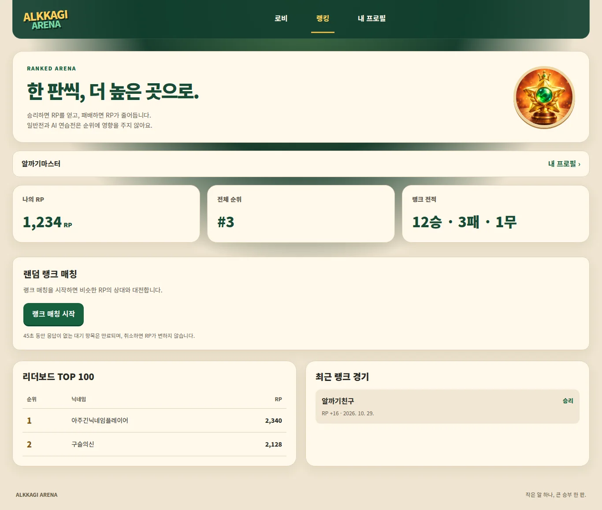
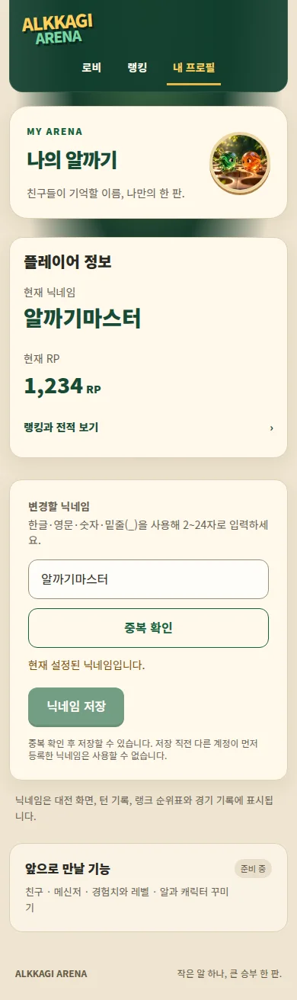

# 디자인 구현 현황 및 시스템 작업 경계

2026-10-29 · 상위 #51 · 사용자 PC/모바일 시안 승인 후 구현.

## 공통 기반 #52

- 브랜치 `feat/52-brand-foundation`.
- `src/app/arena.css`: `.arena` 아래에서만 적용되는 크림/에메랄드/우드 테마.
- `src/components/ui/arena.tsx`: ArenaShell / ArenaHero / ArenaModeCard / ArenaPanel.
- `src/app/layout.tsx`: 전용 스타일 import만 추가. 기존 globals.css와 경기 레이아웃 유지.
- `public/art/{hero,casual,ranked,ai}.webp`: 자체 생성한 장식 일러스트, 글자/버튼은 HTML.
- 에셋 제작: built-in imagegen, 2026-10-29. 프롬프트 방향: 목재 탁자와 숲, 녹색·주황·파랑 유리알 마스코트 / 일반전 두 알 / 금빛 메달 / AI 로봇. UI·글자 없는 독립 에셋으로 생성 후 WebP 최적화.
- 이미지에는 사용자 데이터나 실제 게임 판정 정보를 포함하지 않음.

## 시스템 담당이 확인할 계약

- 디자인에서 `supabase/**`, `src/lib/**`, 서버 actions/API는 수정하지 않음.
- #54 로비 AI 바로 시작에는 서버 계약 필요: difficulty 입력, 성공 room id/redirect, 중복 요청 및 생성 후 시작 실패 복구.
- 계약 전에는 기존 방 생성 → 대기실 AI 추가를 사용하며 바로 시작 완료로 표시하지 않음.
- 공유 페이지/컴포넌트의 수정 예약과 상태는 #51~#56 이슈가 기준. 시작/커밋/PR/검증 시 기록.
- DB·인증·매칭·RP·물리·채팅 의미 변경은 별도 시스템 PR에서 처리.

## 검증 경계

현재 기반은 opt-in이며 실제 페이지 적용은 #53 이후. 시각 회귀 결과와 실제 연동 결과는 각 PR에 별도 기록. 테스트용 빈 데이터/fixtures는 운영 데이터가 아님.

## 페이지 적용 #53

- 브랜치 `feat/53-game-lobby`, #52 기반의 별도 PR. **사용자 지시로 병합하지 않음.**
- 시작 화면의 개발 예정 문구를 현재 플레이 가능한 기능으로 수정.
- 로그인/가입은 기존 AuthForm·인증·콜백 오류 처리 유지, 주변 레이아웃과 색상만 변경.
- 로비: 세 가지 모드, 내 닉네임/RP, 실제 ranked_dashboard TOP3, 일반전/AI 경기 복귀.
- 조회 실패와 실제 빈 목록 구분. 가상 RP·레벨·순위 수치 없음.
- 일반전은 기존 RoomForms를 대화상자로 제공. AI는 기존 createRoom → 대기실 AI 추가 경로. #54의 빠른 시작은 아직 미구현.
- `LobbyView`는 표시 전용이며 시스템 담당이 데이터를 전달할 수 있도록 props 경계를 분리.

### 브라우저 검증

- Chromium에서 320/390/768/1366/1440px, 랜딩/로그인/회원가입/로비 fixture 20개 조합 가로 overflow 없음.
- 일반전 대화상자 열기, 초대 코드 입력, Escape 닫기·트리거 포커스 복귀, AI 경로 안내, reduced-motion 확인. 페이지 JS 오류 없음.
- `docs/ui-evidence/` 이미지는 **로비의 테스트용 데이터/인증 서비스 미설정 환경**에서 촬영. 실제 운영 계정이나 순위가 아님.
- 테스트용 `design-check` 경로는 검증 후 제거했으며 PR/배포에 포함하지 않음.
- 로컬 인증 환경 미설정으로 실제 계정 가입·로그인·두 사용자 매칭/경기 E2E는 이번 변경에서 재실행하지 않음. 기존 서버 테스트 통과와 구분.

## 대기실/경기 UI #54·#55

- 대기실: 초대 코드 복사·실패 안내, 선공/후공 슬롯, AI 선택 상태 색상.
- 경기: 장식 전용 CourtSurface를 일반/랭크/AI에서 공유. viewBox 800×500, piece radius, 포인터 좌표·샷 요청 로직 유지.
- 채팅/로그/선수/결과 카드 크림 테마. 모바일 결과 카드는 최종 보드 아래로 펼쳐 재대전 버튼이 작은 보드 안에 잘리지 않게 표시.
- Chromium fixture: 320/390/768/1366/1440px × 대기/일반/AI/결과 20조합 가로 넘침 없음. 1366×768, 1440×768 경기 문서 높이=viewport(페이지 스크롤 없음).
- 실제 GameBoard 컴포넌트에서 알 p0를 30 보드 좌표만큼 당겨 `pieceId=p0, dx=30` 요청 확인, 드래그 전/중 보드 크기 동일. API는 409 fixture 응답을 사용했으며 실제 DB 경기 진행 검증 아님.
- 페이지 JS 오류 없음. 데스크톱 결과 overlay/기존 3열·모바일 문서 스크롤 유지. 플레이어 실제 경쟁/채팅 서버 전송/AI 응수 E2E는 별도 확인 대상.

## #56 랭킹·내 프로필

기존 ranked_dashboard RPC와 본인 profiles 쿼리를 유지하고 표시 컴포넌트로 분리했습니다. 조회 실패는 오류와 대시로 표시하며 가짜 RP를 만들지 않습니다. 기존 매칭/닉네임 중복 확인·저장 액션을 재사용합니다. 공개 프로필 API #59는 후속 연동입니다.

320/390/768/1366/1440px에서 랭킹·프로필 정상/오류 20개 조합의 가로 넘침 없음, 브라우저 JS 오류 없음. QA는 임시 fixture를 사용했고 해당 경로는 제거했습니다. 실제 계정/DB의 인증·매칭 종단 검증은 수행하지 않았습니다.

