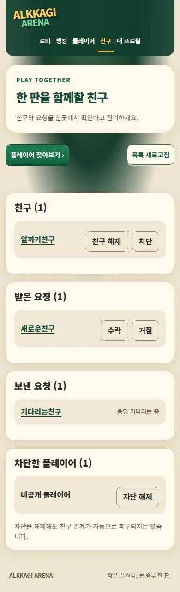
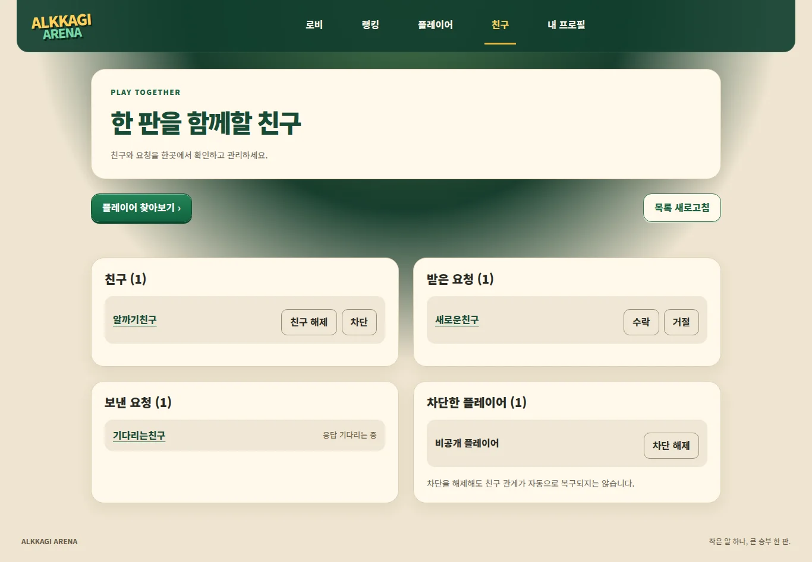

# 친구 UI 인계

상위 #92 / 목록·액션 #93 / 요청·활성화 #94 / 검증 #95. `feat/friends-ui`, 기준 main `3638782`. API 계약은 `docs/friends-api-v1.md`를 따릅니다.

## 활성화 경계

**기본은 준비 중입니다.** 서버 환경변수 `FRIENDS_UI_ENABLED`가 정확히 `true`인 경우에만 `/friends`의 목록 컴포넌트와 공개 프로필의 친구 요청 버튼을 렌더링합니다. 기본 상태에서 친구 API를 호출하지 않습니다. 플래그는 UI 노출 제어이며 보안 권한을 대체하지 않습니다. 서버 API의 인증·권한 검증은 그대로입니다.

운영 DB 친구 마이그레이션 적용 및 실제 두 계정 인수 검증을 확인한 뒤 별도 활성화해야 합니다. 이번 작업에서는 환경변수·운영 DB·Vercel 배포 설정을 변경하지 않았습니다. PR 병합 및 수동 재배포도 하지 않습니다. Vercel 무료 한도 상황에서는 로컬 검증과 GitHub CI를 우선합니다.

## 사용자 흐름

- 상단 친구 → 친구/받은 요청/보낸 요청/차단한 플레이어. 플레이어 검색으로 연결.
- 공개 프로필에서 본인이 아닌 상대에게 친구 요청. 이미 대기 중이면 중복 요청 안내, 교차 요청이면 친구 화면의 받은 요청 안내.
- 수락/거절: 요청 ID로 POST respond. 친구 해제: 사용자 ID로 DELETE. 차단/해제: 사용자 ID로 PUT blocked.
- 액션은 대상을 표시하는 확인창에서 확정. 처리 중 중복 클릭과 Escape 종료 방지, 취소 시 원래 버튼으로 포커스 복귀.
- 성공 후 서버 목록 재조회. 실패는 성공/빈 목록으로 표시하지 않으며 새로고침/재시도 가능. 401에서는 기존 목록을 숨기고 로그인 링크 제공.
- `blocked[].nickname === null`은 비공개 플레이어로 표시. 해당 항목은 프로필 링크/추가 조회 없음.
- 친구 해제/차단 해제는 기존 관계 자동 복구를 약속하지 않습니다. DM/온라인 상태/방 초대/보낸 요청 취소는 이번 UI에 포함하지 않습니다.

## 변경 파일과 병행 작업

`src/components/friends/**`, `/friends/page.tsx`, 공개 프로필 요청 슬롯, 공통 메뉴와 arena.css, UI 테스트 및 이 문서. `src/proxy.ts`는 `/friends/:path*` matcher만 추가하며 기존 플레이어/메시지 등 경로를 보존합니다. 다른 시스템 PR의 matcher를 통합할 때 양쪽 항목을 유지해야 합니다. API/SQL/RP/물리 로직 변경 없음.

## 검증

실제 표시 컴포넌트를 임시 fixture에 올려 API를 모의 응답한 브라우저 검증입니다. 임시 경로와 모의 데이터는 커밋하지 않습니다.

- 수락/거절의 요청 ID와 해제/차단의 사용자 ID, HTTP method/body 확인
- 두 번 클릭해도 1회 전송, 취소 시 미전송 및 포커스 복귀
- 차단 실패→재시도 성공, 서버 목록 갱신; 503 조회 실패를 빈 목록으로 숨기지 않음
- 401 액션 실패 시 기존 목록 제거, 로그인 복구 링크
- 비공개 차단 항목 추가 프로필 조회 없음
- 비활성 상태 및 본인 프로필에 요청 버튼 없음; 교차 요청 안내, 성공 후 재전송 비활성
- 320/390/768/1366/1440px 친구 화면·확인창 가로 넘침 없음, 브라우저 JS 오류 없음

실제 계정 두 개의 DB/권한 반영 E2E는 미검증입니다. 플래그 활성화/운영 배포 완료와 혼동하지 않습니다.

## 검토 화면 (활성화된 UI, API 모의 응답)

최종 로컬 검증: lint/typecheck, 38개 파일 178개 테스트, Next.js production build 통과.
