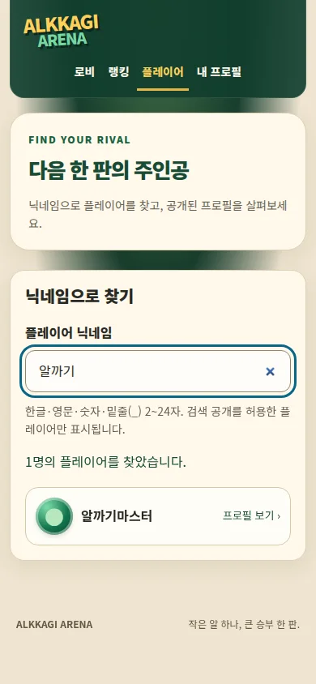
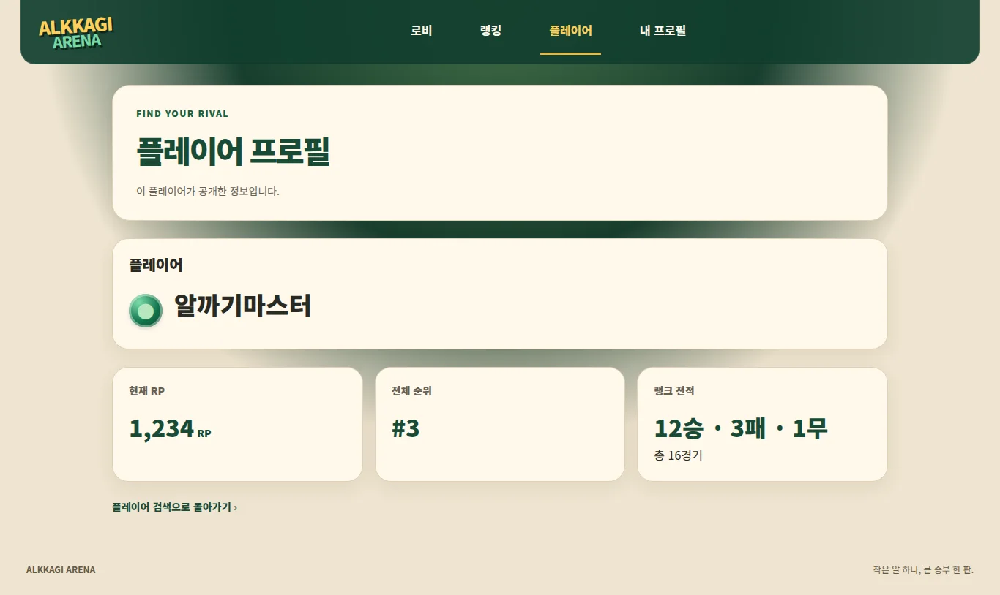
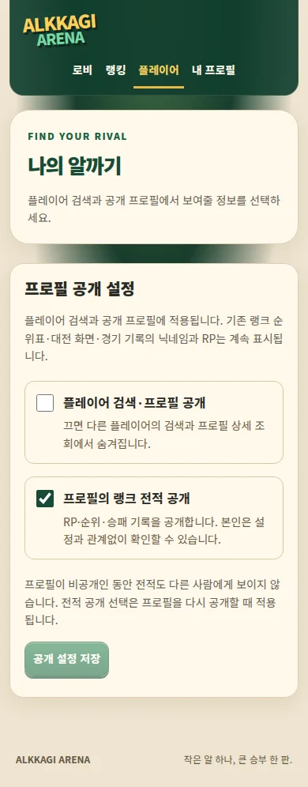

# 플레이어 검색·공개 프로필 UI

상위 #86 / 검색·상세 #87 / 공개 설정 #88 / 검증 #89. 기준 main `50ff7f1`. 기존 `docs/player-profile-api-v1.md`의 API를 사용하는 UI 구현이며 친구·DM·방 초대는 포함하지 않습니다.

## 진입과 동작

- 상단 **플레이어** 메뉴 → `/players`. 로그인 확인 후 닉네임 2~24자 입력, 300ms 뒤 검색. 한글 조합 중 요청하지 않으며 입력 변경/화면 이탈 시 이전 요청을 취소합니다. 응답 경합 중 이전 결과를 숨깁니다.
- 검색 결과 → `/players/[id]`. 공개 닉네임·RP·순위·승패를 표시하고 `ranked:null`은 전적 비공개로 안내합니다. 없는/비공개 사용자는 동일 안내, 세션 만료는 로그인 이동, 서비스 오류는 재시도를 제공합니다.
- `/profile` 기존 닉네임 편집 아래 공개 설정. 초기 GET 응답 전에는 토글을 표시하지 않습니다. PUT 응답 성공 이후만 저장 완료로 표시하고 중복 저장 요청을 막습니다.
- **공개 설정은 검색/공개 프로필 API에만 적용**됩니다. 기존 랭크 순위표와 경기 기록은 바뀌지 않습니다. 비공개 전환은 친구/대전 기록 삭제 기능이 아닙니다.
- 새 보호 페이지의 직접 진입을 위해 `src/proxy.ts` matcher에 `/players/:path*`만 추가. 인증 로직, API, SQL, 물리/RP는 수정하지 않았습니다. 시스템 PR의 다른 matcher 추가와 통합할 때 양쪽 항목을 보존해야 합니다.

## 검증

단위 테스트는 초기 로딩 시 가짜 데이터·기본 설정 미표시, 상태별 복구 링크, same-origin/no-store 요청, 서버 오류 본문 미노출, 두 페이지의 인증 가드·UUID 검증·세션 matcher를 확인합니다.

브라우저 검증은 실제 표시 컴포넌트를 임시 fixture에 탑재하고 API 응답을 가로채 수행했습니다. 운영 데이터를 사용한 검증이 아닙니다.

- 한글 IME 조합 중 검색 보류, Tab으로 결과 링크 접근
- 느린 이전 검색 응답이 최신 결과를 덮어쓰지 않음
- 검색 결과 없음, 503 재시도 성공, 401 세션 만료 시 이전 결과 제거
- 전적 비공개 시 RP 미노출, 404에서 닉네임 미노출
- 설정 저장 503 시 성공 문구 미표시, 재시도 성공, 저장값 재조회 일치
- 320/390/768/1366/1440px × 검색/프로필/설정 15개 조합 가로 넘침 없음, 브라우저 JS 오류 없음

임시 fixture와 테스트용 API 데이터는 배포 코드에 포함하지 않습니다. 실제 로그인한 두 계정의 설정 변경→상대 검색/상세 반영 확인은 추가 인수 검증이 필요합니다. 병합과 운영 DB 변경은 수행하지 않습니다.

## 검토용 화면 (API 모의 응답)

최종 검증: lint/typecheck 및 35개 파일 156개 테스트 통과. Next 개발 캐시 읽기 오류 발생 후 `.next` 캐시를 분리하고 깨끗한 프로덕션 빌드를 다시 실행해 성공했습니다.

## 병합 이후 업데이트 (2026-10-29)

PR #91은 **main 병합 완료**(`3638782`). 위의 '병합하지 않았다'는 구현 당시 상태 설명입니다. `src/proxy.ts`의 플레이어/DM 갱신 경로 충돌은 통합했고 Quality checks #40824522622 성공을 기록했습니다. 최신 Vercel 배포는 무료 한도로 미확인, 실제 두 계정 공개 설정→상대 검색과 시각 검수는 별도입니다. [통합 인수](current-status-2026-10-29.md).
